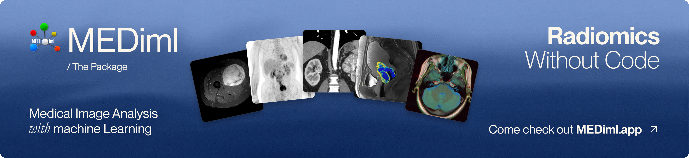
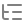
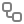
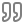

<p align="center">
  <a href="https://mediml.app">
    
  </a>
</p>

<p align="center"><strong>A Python package for radiomics and dosiomics feature extraction.</strong></p>

<p align="center">
  <a href="https://www.python.org/downloads/"></a>
  <a href="https://pypi.org/project/mediml/"></a>
  <a href="https://github.com/MEDomicsLab/MEDiml-pkg/actions/workflows/python-app.yml"></a>
  <a href="https://mediml.readthedocs.io/en/latest/"></a>
  <a href="LICENSE.md"></a>
  <a href="https://colab.research.google.com/github/MEDomicsLab/MEDiml-pkg/blob/main/notebooks/tutorial/DataManager-Tutorial.ipynb"></a>
</p>

<p align="center">
  <picture></picture>&nbsp;<a href="https://mediml.readthedocs.io/en/latest/">Documentation</a>
  &nbsp;&nbsp;·&nbsp;&nbsp;
  <picture></picture>&nbsp;<a href="https://mediml.app">Website</a>
  &nbsp;&nbsp;·&nbsp;&nbsp;
  <picture></picture>&nbsp;<a href="https://arxiv.org/abs/2610.37715">Paper&nbsp;(Submitted)</a>
  &nbsp;&nbsp;·&nbsp;&nbsp;
  <picture></picture>&nbsp;<a href="https://arxiv.org/abs/2610.29666">Reference&nbsp;Manual</a>
</p>

<a id="package-workflow"></a>


## <a id="table-of-contents"></a> Table of Contents
  * [Introduction](#introduction)
  * [Installation](#installation)
  * [Using MEDiml](#using-mediml)
  * [Tutorials](#tutorials)
  * [IBSI Standardization](#ibsi-standardization)
  * [Getting help](#getting-help)
  * [Contributing](#contributing)
  * [Acknowledgement](#acknowledgement)
  * [Citation](#citation)
  * [License](#license)

## <a id="introduction"></a> Introduction

MEDiml-pkg is an open-source Python package that can be used for processing multi-modal medical images (MRI, CT or PET) and for extracting their radiomic features. It is also the computational engine behind [MEDiml-app](https://www.mediml.app/), the desktop application for conducting radiomics workflows without writing code. This package is meant to facilitate the processing of medical images and the subsequent computation of all types of radiomic features whilst maintaining the reproducibility of analyses. This package has been standardised with the [IBSI](https://theibsi.github.io/) norms.

See the [workflow figure at the top](#package-workflow) for a step-by-step overview of the package, from medical image datasets and preprocessing to radiomic feature extraction and machine learning.

## <a id="installation"></a> Installation

### Python installation

The MEDiml package requires *Python 3.8*, *3.9* or *3.10*. If you don't have it installed on your machine, follow the instructions [here](https://github.com/MEDomicsLab/MEDiml-pkg/blob/main/python.md) to install it.

### Package installation

You can easily install the ``MEDiml`` package from PyPI using:
```
pip install MEDiml
```

Or, with [uv](https://docs.astral.sh/uv/) (the fastest Python package and project manager):
```
uv pip install mediml                    # into your current environment
uv add mediml                            # into a uv project
uv tool install --python 3.10 mediml     # only the `radiomics` command, in its own environment
```
If your uv project uses Python 3.11 or newer, create one for Python 3.10 instead: `uv init --python 3.10`.

For more installation options (Conda, Poetry...) check out the [installation documentation](https://mediml.readthedocs.io/en/latest/Installation.html).

## <a id="using-mediml"></a> Using MEDiml

MEDiml can be used either as a command line tool for batch radiomics extraction, or as a Python package that you import directly into your own scripts and notebooks for finer-grained control over the processing and feature extraction pipeline.

### Using MEDiml through the command line

After installation, you can launch radiomics extraction directly from the terminal:

```bash
radiomics <path/to/input> <path/to/settings_file> <path/save> --use-niftis --n-batch 4 --skip-existing
```

By default, every scan found in the input folder is processed, and all the ROIs of a scan are
combined into a single region (i.e. `{ROI_1}+{ROI_2}`). To process a specific list of scans and
ROIs instead, pass a [CSV file](https://mediml.readthedocs.io/en/latest/csv_file.html) with the
optional `--path-csv` argument:

```bash
radiomics <path/to/input> <path/to/settings_file> <path/save> --path-csv <path/to/csv_file>
```

The command wraps the existing `BatchExtractor` workflow and selects the appropriate input format automatically. The full list of arguments, required ones first, is described below:

| Argument | Required | Description |
| --- | --- | --- |
| `path_input` | Yes | Path to the [input dataset](https://mediml.readthedocs.io/en/latest/input_data.html) folder containing the scans to process. |
| `path_settings` | Yes | Path to the radiomics [extraction settings file](https://mediml.readthedocs.io/en/latest/configurations_file.html#features-extraction). |
| `path_save` | Yes | Path to the folder where the extracted feature files will be written. |
| `--path-csv` | No | Path to a [CSV file](https://mediml.readthedocs.io/en/latest/csv_file.html) mapping specific scans to specific ROIs (columns: `PatientID`, `ImagingScanName`, `ImagingModality`, `ROIname`). If omitted, every scan found in the input folder is processed and all of its ROIs are combined into a single region. |
| `--use-niftis` | No | Process NIfTI files instead of DICOM files. This is the default behavior and is mutually exclusive with `--use-dicoms`. |
| `--use-dicoms` | No | Process DICOM files instead of NIfTI files. Mutually exclusive with `--use-niftis`. |
| `--n-batch` | No | Number of CPU cores to use for extraction. Defaults to `4`. |
| `--skip-existing` | No | Skip scans whose features already exist in the output folder. |

### Using MEDiml through code

```python
import os
import pickle

import MEDiml

# Load MEDiml DataManager
dm = MEDiml.DataManager(path_dicoms=os.getcwd())

# Process the DICOM files and retrieve the MEDiml object
med_obj = dm.process_all_dicoms()[0]

# Extract ROI mask from the object. `name_roi` is optional: when it is omitted,
# the union of all the ROIs found in the object is used.
vol_obj_init, roi_obj_init = MEDiml.processing.get_roi_from_indexes(
            med_obj,
            name_roi='{ED}+{ET}+{NET}',
            box_string='full')

# Extract features from the imaging data
local_intensity = MEDiml.biomarkers.local_intensity.extract_all(
                img_obj=vol_obj_init.data,
                roi_obj=roi_obj_init.data,
                res=[1, 1, 1]
            )

# Update radiomics results class
med_obj.update_radiomics(loc_int_features=local_intensity)

# Saving radiomics results
med_obj.save_radiomics(
                scan_file_name='STS-UdS-001__T1.MRscan.npy',
                path_save=os.getcwd(),
                roi_type='GrossTumorVolume',
                roi_type_label='GTV',
            )
```

## <a id="tutorials"></a> Tutorials

We have created many [tutorial notebooks](https://github.com/MEDomicsLab/MEDiml-pkg/tree/main/notebooks) to assist you in learning how to use the different parts of the package. More details can be found in the [documentation](https://mediml.readthedocs.io/en/latest/tutorials.html).

## <a id="ibsi-standardization"></a> IBSI Standardization

The image biomarker standardization initiative ([IBSI](https://theibsi.github.io)) is an independent international collaboration that aims to standardize the extraction of image biomarkers from acquired imaging. The IBSI therefore seeks to provide image biomarker nomenclature and definitions, benchmark datasets, and benchmark values to verify image processing and image biomarker calculations, as well as reporting guidelines, for high-throughput image analysis. We participate in this collaboration with our package to make sure it respects international nomenclatures and definitions. The participation was separated into two chapters:

### IBSI Chapter 1

[The IBSI chapter 1](https://theibsi.github.io/ibsi1/) is dedicated to the standardization of commonly used radiomic features. It was initiated in September 2016 and reached completion in March 2020. We have created two [jupyter notebooks](https://github.com/MEDomicsLab/MEDiml-pkg/tree/main/notebooks/ibsi) for each phase of the chapter and made them available for the users to run the IBSI tests for themselves. The tests can also be explored in interactive Colab notebooks that are directly accessible here:

- **Phase 1**: [](https://colab.research.google.com/github/MEDomicsLab/MEDiml-pkg/blob/main/notebooks/ibsi/ibsi1p1.ipynb)
- **Phase 2**: [](https://colab.research.google.com/github/MEDomicsLab/MEDiml-pkg/blob/main/notebooks/ibsi/ibsi1p2.ipynb)

### IBSI Chapter 2

[The IBSI chapter 2](https://theibsi.github.io/ibsi2/) was launched in June 2020 and reached completion in February 2024. It is dedicated to the standardization of commonly used imaging filters in radiomic studies. We have created two [jupyter notebooks](https://github.com/MEDomicsLab/MEDiml-pkg/tree/main/notebooks/ibsi) for each phase of the chapter and made them available for the users to run the IBSI tests for themselves and validate image filtering and image biomarker calculations from filter response maps. The tests can also be explored in interactive Colab notebooks that are directly accessible here:

- **Phase 1**: [](https://colab.research.google.com/github/MEDomicsLab/MEDiml-pkg/blob/main/notebooks/ibsi/ibsi2p1.ipynb)
- **Phase 2**: [](https://colab.research.google.com/github/MEDomicsLab/MEDiml-pkg/blob/main/notebooks/ibsi/ibsi2p2.ipynb)

Our team named *UdeS* (a.k.a. Université de Sherbrooke) has already submitted the benchmarked values to the [IBSI uploading website](https://ibsi.radiomics.hevs.ch/).

<details>
<summary><strong>Run IBSI tests locally</strong></summary>

You can view and run the tests locally with [Jupyter Notebook](https://jupyter.org/). If it is not already installed on your machine, install it using:
```
python -m pip install jupyter
```

Then access the IBSI tests folder using:

```
cd notebooks/ibsi/
```

Finally, launch Jupyter Notebook to navigate through the IBSI notebooks using:

```
jupyter notebook
```

Make sure to run the notebooks with a Jupyter kernel that has `MEDiml` installed. If that's not the case, you can simply install it from within the notebook by running the following in a code cell:

```
! pip install MEDiml
```

</details>

## <a id="getting-help"></a> Getting help

- **Bugs and feature requests**: open an issue on [GitHub Issues](https://github.com/MEDomicsLab/MEDiml-pkg/issues).
- **Questions and discussion**: join the [MEDomics Discord](https://discord.gg/ZbaGj8E6mP).

## <a id="contributing"></a> Contributing

Contributions are welcome. See [CONTRIBUTING.md](CONTRIBUTING.md) and our [Code of Conduct](CODE_OF_CONDUCT.md).

## <a id="acknowledgement"></a> Acknowledgement

MEDiml is an open-source package developed at the [MEDomicsLab](https://www.medomicslab.com/en/) laboratory with the collaboration of the international consortium [MEDomics](https://www.medomics.ai/). We welcome any contribution and feedback. Furthermore, we wish that this package could serve the growing radiomics research community by providing a flexible as well as [IBSI](https://theibsi.github.io/) standardized tool to reimplement existing methods and develop new ones.

## <a id="citation"></a> Citation

If you use MEDiml in your research, please cite it using:

```bibtex
@misc{loutfi2026mediml,
  title         = {Medical Image Analysis with Machine Learning ({MEDiml}): Strategies for Simpler Radiomics},
  author        = {Ait Lhaj Loutfi, Mahdi and others},
  year          = {2026},
  eprint        = {2610.37715},
  archiveprefix = {arXiv},
  doi           = {10.48550/arXiv.2610.37715}
}
```

The [MEDiml reference manual](https://arxiv.org/abs/2610.29666) explains the radiomics concepts and workflow shared by the Python package and desktop application, including image preprocessing, feature extraction, predictive modelling and interpretation. It also covers the software architecture and installation, compares MEDiml with other tools, and illustrates its use on five oncological imaging cohorts.

## <a id="license"></a> License

MEDiml-pkg is released under the [GNU General Public License v3.0](LICENSE.md).
